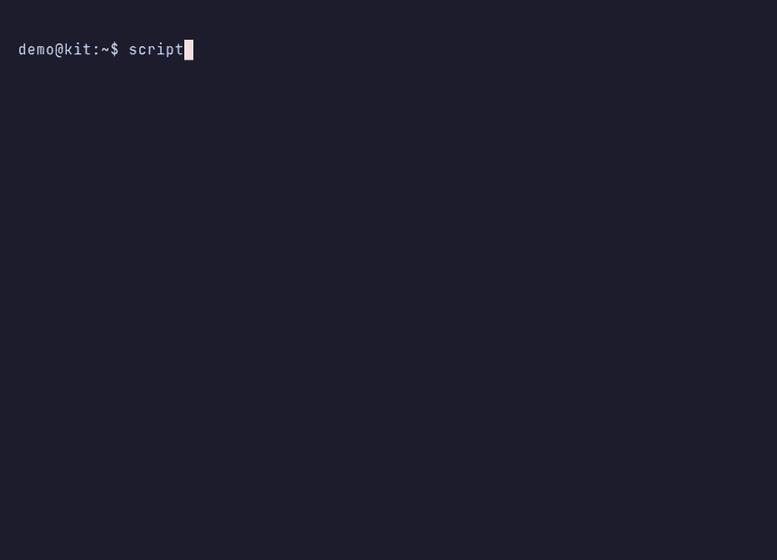

# Second brain installer

Paste this link to your agent and say **install this**:

https://github.com/zachpippin/obsidian-gbrain-starter

The agent reads [AGENTS.md](AGENTS.md) and [INSTALL.md](INSTALL.md), then installs [Obsidian](https://obsidian.md) and [gbrain](https://github.com/garrytan/gbrain) around a starter vault of plain Markdown. When Zach publishes this repository he may rename it to `second-brain-installer`. Until that rename exists, use the URL above.

gbrain and Obsidian are separate projects. This installer is not affiliated with either of them.

## What you get

- An Obsidian vault at `$HOME/SecondBrain` (or the Windows user-profile folder of the same name). Existing notes are not overwritten.
- A keyless gbrain index of that vault. Search works without an API key. Embeddings and ambient writeback stay off.
- A background job that re-indexes notes every 15 minutes, and a daily update of gbrain and, on Linux, Obsidian.
- `scripts/doctor.sh` for versions, the last update, job status, and whether search works.
- `scripts/uninstall.sh` to remove the jobs without deleting notes.

The sample notes are fiction about Sam Rivera, a hobbyist woodworker and developer. They are not a real person's notes. The vault's `AGENTS.md` tells an agent to search before answering and to write decisions back.

## Demo



The clip copies the sample vault, searches for Sam Rivera's garden planner, writes a session note with a scripted stand-in (not a live model), syncs, and searches for that new text. The prompt is `demo@kit:~$`. A still frame is at [docs/demo-still.png](docs/demo-still.png). Re-record with [vhs](https://github.com/charmbracelet/vhs) from [docs/demo.tape](docs/demo.tape).

From the shell, the same lookup is:

```sh
gbrain search "offline bed map" --source obsidian-vault
```

The decision in the sample is: bed maps stay on the device.

## Agent, or by hand

Give the agent the repository URL and the words `install this`. It should follow [INSTALL.md](INSTALL.md) and the permissions doc for your OS:

- [Linux](docs/permissions-linux.md)
- [macOS](docs/permissions-macos.md)
- [Windows](docs/permissions-windows.md)

By hand, from a checkout:

```sh
scripts/install.sh
scripts/doctor.sh
```

`scripts/install.sh --no-jobs` skips the background sync and update schedules.

On Windows, run `scripts/install.ps1` in PowerShell. gbrain is installed inside WSL 2. That is the v1 Windows path. A native Windows gbrain install was not verified.

Updates, pins, and rollback are described in [docs/updates.md](docs/updates.md).

## Layout

| Path | Use |
| --- | --- |
| `vault/` | Starter notes copied into the destination vault |
| `scripts/install.sh`, `scripts/install.ps1` | Installers |
| `scripts/update.sh`, `scripts/doctor.sh`, `scripts/uninstall.sh` | Update, status, and job removal |
| `scripts/setup.sh`, `scripts/sync.sh` | Vault copy and index sync used by the installer |
| `docs/permissions-*.md` | What the person has to click or type |
| `agents/` | Extra copies of the vault rules, plus a Hermes skill |

A fresh brain is created with:

```sh
gbrain init --pglite --no-embedding --non-interactive --search-mode conservative --db-only
```

`--db-only` keeps init from adopting this git repository as the brain's content root. The vault is added afterwards as source `obsidian-vault`.

## Not verified here

The Linux path was smoke-tested in the development environment. macOS and Windows were not run on those operating systems. Windows Obsidian upgrades through winget do not have a tested rollback, so the daily job updates gbrain only. See the pull request for the exact test log.

Default pack `gbrain-base-v2` does not declare `topic`, `session`, `inbox`, or `map`. Import stores them as-is and warns. This installer does not fork a schema pack.

## Credits

- [gbrain](https://github.com/garrytan/gbrain) by Garry Tan, MIT.
- [Obsidian](https://obsidian.md), a separate product. The starter vault uses core plugins only.

## License

MIT. Copyright (c) 2026 Zach Pippin. See [LICENSE](LICENSE).
