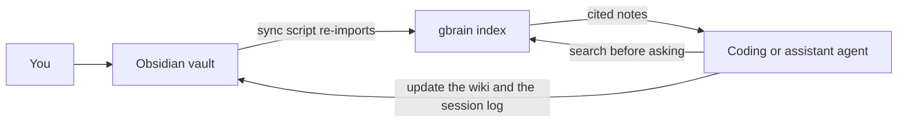

# Obsidian + gbrain starter

Copy a working personal second brain, and the memory hook for your AI agent, in a few commands.

This repository is a template [Obsidian](https://obsidian.md) vault plus scripts that index it with [gbrain](https://github.com/garrytan/gbrain) (MIT). After setup, an agent can search the notes and write updates back as markdown. The sample vault is fiction about Sam Rivera, a hobbyist woodworker and developer. It is not a real person's notes.

gbrain and Obsidian are separate projects. This kit is not affiliated with either of them.

## Demo

Ask your agent:

> What did Sam Rivera decide about offline bed maps in the garden planner?

Watch it search, find `wiki/projects/garden-planner.md`, and cite `inbox/2026-03-02-raised-bed-sketch.md`. The decision in the sample is: bed maps stay on the device. Then look at `sessions/`. The agent should append today's date as `sessions/YYYY-MM-DD.md` instead of inventing a second project page.

From the shell, the same lookup is:

```sh
gbrain search "offline bed map" --source obsidian-vault
```

## Quick start

You need Git, Python 3, and [Bun](https://bun.sh) 1.4.0 or newer if gbrain is not already installed. Obsidian is only required when you want to browse the vault. gbrain is not the npm package named `gbrain`. Install it from GitHub, which is what `scripts/setup.sh` does.

```sh
git clone https://github.com/zachpippin/obsidian-gbrain-starter.git
cd obsidian-gbrain-starter
scripts/setup.sh "$HOME/SecondBrain"
```

Setup copies `vault/` to the path you choose, creates a keyless local brain when you do not already have one, registers the copy as a federated gbrain source, and imports the markdown. Run it again on the same path: it will not overwrite files that are already there.

Then open that folder in Obsidian. Core plugins only. No community plugins.

After you edit notes:

```sh
scripts/sync.sh "$HOME/SecondBrain"
```

## How it works



The markdown files are what you read in Obsidian. gbrain is the index agents search. `scripts/sync.sh` runs `gbrain import` so edits on disk are re-read, including notes you have not committed, then `gbrain sync --no-pull --no-embed` so the git checkpoint moves without fetching into your vault and without calling an embedding provider.

A fresh brain is created with:

```sh
gbrain init --pglite --no-embedding --non-interactive --search-mode conservative --db-only
```

`--db-only` keeps init from adopting this git repository as the brain's content root. The vault is added afterwards:

```sh
gbrain sources add obsidian-vault --path DEST --federated --name "Obsidian vault"
gbrain sources attach obsidian-vault
gbrain import DEST --source obsidian-vault --no-embed
gbrain sync --source obsidian-vault --no-pull --no-embed
```

`--search-mode` accepts `conservative`, `balanced`, or `tokenmax`. Non-interactive setup records `conservative` unless you set `GBRAIN_SEARCH_MODE`. That flag is only passed when a brain does not exist yet. This script never passes `--force`.

Keyword search works with no API key. Embeddings, synthesis, ambient writeback, and connectors stay off unless you turn them on yourself.

## Layout

```text
vault/                  template Obsidian vault
  inbox/                raw captures
  wiki/people/          one page per person
  wiki/projects/        one page per project
  wiki/topics/          shared concepts
  sessions/             agent logs, YYYY-MM-DD.md
  templates/            person, project, topic, session, inbox
  attachments/          files linked from notes
  .obsidian/            core plugins only
agents/                 Hermes skill and copies of the policy
scripts/setup.sh        copy, init, register, import
scripts/sync.sh         re-import changed notes
scripts/scrub-check.sh  refuse secrets and private identifiers
scripts/mcp/            example MCP configs
AGENTS.md               Codex and everyone else
CLAUDE.md               Claude Code
```

Notes use this frontmatter:

```yaml
---
type: project
tags:
  - projects
created: YYYY-MM-DD
updated: YYYY-MM-DD
sources:
  - "[[inbox/2026-03-02-raised-bed-sketch]]"
---
```

`type` is `person`, `project`, `topic`, `session`, `inbox`, or `map` for the vault home page. `sources` is a citation list. It is not the gbrain source id.

The sample has one invented person, Sam Rivera, plus a garden app, a podcast, a home lab, a workbench, topic notes, inbox captures, and session logs. One capture is still unfiled so you can see the difference.

## Agents

`AGENTS.md` is the policy: search before asking, log every session, update the wiki page instead of duplicating it, never store secrets, cite sources.

| Client | What to use |
| --- | --- |
| Codex and other root-instruction agents | `AGENTS.md` |
| Claude Code | `CLAUDE.md` |
| Hermes | `agents/hermes/SKILL.md`, copied into your Hermes skills directory |
| Grok Bot and any other MCP client | the same `AGENTS.md` rules, plus `scripts/mcp/gbrain.mcp.json` |

Local registration, as gbrain documents it:

```sh
claude mcp add gbrain -- "$(command -v gbrain)" serve --surface full
codex mcp add gbrain -- "$(command -v gbrain)" serve --surface full
```

PGLite allows one process to own the database at a time. Do not start two `gbrain serve` processes on the same brain.

For a remote client, follow gbrain's own guide rather than this kit. Setup does not publish the brain.

An optional second config, `scripts/mcp/mcp-obsidian.mcp.json`, is the MIT project [mcp-obsidian](https://github.com/MarkusPfundstein/mcp-obsidian). It needs Obsidian running and the Local REST API community plugin. This template does not require that plugin. The default write path is the markdown files.

## FAQ

**Does the agent need Obsidian to be open?**
No. gbrain and the sync script read the folder. Open Obsidian when you want to browse.

**Will setup replace a brain I already have?**
No. If `gbrain engine status` already shows an engine, setup reuses it and does not pass `--force`. If the source id `obsidian-vault` already points somewhere else, setup stops and prints `gbrain sources set-path`.

**Why is search keyword-only?**
The brain is created with `--no-embedding`. An empty semantic-style query can miss a note that does not share words with the query. Say so instead of treating the miss as proof the note does not exist.

**Can I put real notes in the copy?**
Yes, in your destination folder. Do not put secrets, phone numbers, home-directory paths, or non-`example.com` addresses into a copy you might publish. `scripts/scrub-check.sh` is how this repository refuses that. Add private terms to a gitignored `.scrub-denylist` at the repo root, one term per line. Lines starting with `#` are comments. Terms shorter than 3 characters are ignored.

**What did the smoke test actually run?**
See the unverified list below. The commands in this README were checked against gbrain's docs and against `gbrain --help` on 2026-10-23 (`gbrain` 0.60.411.0 from `github:garrytan/gbrain#latest-stable`). `#latest-stable` moves.

## Unverified, or left alone on purpose

- `topic`, `session`, `inbox`, and `map` are not types in the default pack `gbrain-base-v2`. `person` and `project` are. Import and `gbrain put` store the other types as-is and print a warning. Setup does not run `gbrain schema fork` or `gbrain schema add-type`.
- Init may suggest `gbrain config set memory.auto_writeback salient`. Setup does not run that. Saves stay explicit.
- `gbrain apply-migrations --yes --no-autopilot-install` can print a shared-skills `action_required` notice. Setup does not enroll skills or export a content root.
- Changing the search mode on an existing brain is not automated. `gbrain init --help` says an existing mode needs `--force`, and this kit does not pass `--force`.
- The Hermes skills directory is yours to choose. The skill file is `agents/hermes/SKILL.md`.
- Grok Bot's remote path (`gbrain mcp expose`, a memory-writer grant, a thin CLI) is gbrain's guide, not a command this kit runs.
- This kit does not start `gbrain serve` during setup, because a second process can contend for the PGLite lock. The example config is `scripts/mcp/gbrain.mcp.json`. `GBRAIN_SOURCE` is included because gbrain's multi-source guide says a connection started with that variable is bound to that source. An MCP handshake was not part of the default test.
- `gbrain embed` is not run. On a keyless brain, `gbrain embed --stale` is documented to exit 0 and skip the work. The sync script passes `--no-embed` instead.

## Credits

- [gbrain](https://github.com/garrytan/gbrain) by Garry Tan, MIT. Install and command reference: [docs/INSTALL.md](https://github.com/garrytan/gbrain/blob/master/docs/INSTALL.md), [connect a coding agent](https://github.com/garrytan/gbrain/blob/master/docs/tutorials/connect-coding-agent.md), [multi-source brains](https://github.com/garrytan/gbrain/blob/master/docs/guides/multi-source-brains.md), [Hermes](https://github.com/garrytan/gbrain/blob/master/docs/mcp/HERMES.md), [Grok Bot](https://github.com/garrytan/gbrain/blob/master/docs/guides/grok-bot.md).
- [Obsidian](https://obsidian.md), a separate product. This template uses core plugins only.
- Optional write access while Obsidian is running: [mcp-obsidian](https://github.com/MarkusPfundstein/mcp-obsidian), MIT, which depends on a community plugin this vault does not enable.

## License

MIT. Copyright (c) 2026 Zach Pippin. See [LICENSE](LICENSE).
